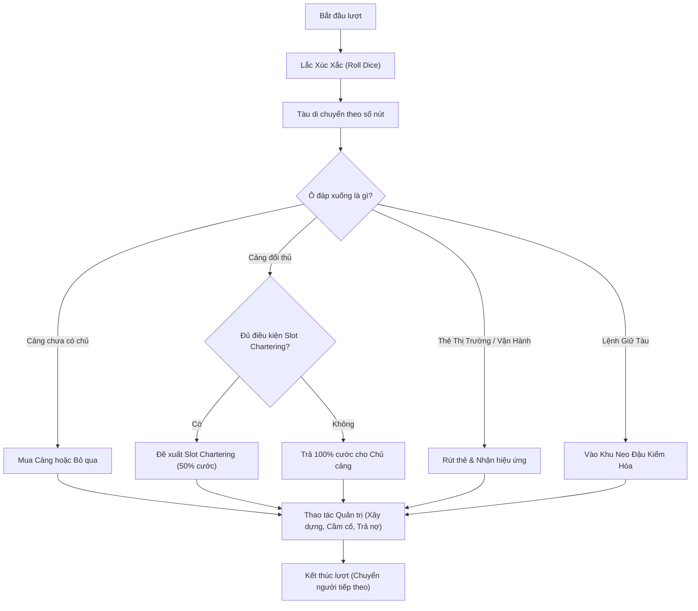

# 🚢 BỘ LUẬT CHƠI ONE MONOPOLY (OCEAN NETWORK EXPRESS)
> **Bản quyền thiết kế:** Chủ đề Hãng tàu Container Toàn cầu Ocean Network Express (ONE)  
> **Quy mô bàn cờ:** 32 Ô (Lưới 9x9 - Góc nhìn 3D Isometric chuẩn Business Tour)  
> **Số người chơi:** 2 – 4 Thuyền trưởng  
> Mỗi thuyền trưởng bắt đầu ở Singapore với **$1.500M** trong Monopoly và Monopoly cổ điển, hoặc **$0M** trong Empty Reposition. Đơn vị M là triệu USD.

---

## Chuyến đầu cho người mới

Chọn **Tạo phòng mới**, nhập tên, chọn quân cờ rồi nhấn **Khởi tạo phòng chơi**. Gửi mã phòng cho bạn bè để họ chọn **Vào bằng mã**, hoặc bắt đầu ngay để đấu với máy. Chủ phòng chọn chế độ trước khi bắt đầu. Bạn có thể mở lại hướng dẫn ở phòng chờ và ngay trên bàn cờ.

### Monopoly

Ở Singapore, bạn có thể xếp một container hàng khô trước khi gieo xúc xắc. Khi đến cảng chưa có chủ, hãy quyết định mua hoặc mở đấu giá. Tại một cảng khác nơi xếp, bạn có thể dỡ hoặc giữ hàng trên tàu. Nếu cập cảng đối thủ mà thiếu tiền thuê, mục **Xử lý công nợ** cho phép dùng cước của lô hàng đang chở để trả thuê. Mỗi lần ghé chỉ được xếp hoặc dỡ một lần. Bạn xếp miễn phí ở Singapore và ở cảng đang hoạt động của mình. Tại cảng đối thủ đã xây ít nhất một cấp, tàu có khoang trống có thể trả phí cho chủ cảng để xếp hàng. **Thắng khi bạn là thuyền trưởng cuối cùng còn khả năng thanh toán.**

Trước khi nhận lô hàng, mở **Vận tải cảng → Bến ở lần gieo tới**. Ví dụ, từ Singapore có hai cách gieo được tổng 3 để đến Cái Mép (1 + 2 hoặc 2 + 1), tức **2/36**. Chọn tên bến để xem cước, phần chủ cảng nhận và tiền thuê. Dự tính dùng quyền sở hữu hiện tại và chỉ đếm các lần gieo đưa tàu thẳng đến cảng. Lá bài có thể đưa tàu đi tiếp.

Nếu Linh xếp hàng miễn phí ở Singapore rồi gieo được 3, cô cập Cái Mép. Minh sở hữu riêng cảng này, chưa xây và chưa thế chấp, nên Linh trả Minh **$4M tiền thuê**. Nếu Linh dỡ hàng, ngân hàng trả thêm **$12M cước**, gồm **$9M cho Linh** và **$3M phí bốc dỡ cho Minh** (25%). Đi tàu trống vẫn phải trả $4M thuê, nên chở lô hàng này giúp Linh kiếm thêm **$9M**. Nếu Minh sở hữu cả Cái Mép và Cát Lái, tiền thuê ở Cái Mép chưa xây là **$8M** và cước chia **$6M mỗi người** (50%). Cảng đang thế chấp tạm dừng xếp dỡ.

Nếu Minh xây cấp 1 ở Cái Mép, tiền thuê tăng lên **$20M**. Lần sau, nếu Linh cập bến với khoang trống, cô trả tiền thuê rồi có thể rời bến hoặc trả thêm **$3M** cho Minh để xếp hàng. Nếu Minh sở hữu cả nhóm màu, phí xếp là **$6M**. Các cấp xây tiếp theo chỉ tăng tiền thuê. Với mức phí xếp $3M, nếu Linh đem lô hàng về dỡ ở Singapore, cô nhận **$12M** khi dỡ. Trừ phí xếp đã trả ở Cái Mép, chuyến hàng mang về **$9M** trước tiền thuê và thưởng qua ô xuất phát.

Khi đang chở hàng, bấm một ô cảng khác hoặc chọn **Sổ cảng** trên hải đồ để dự tính chuyến đi cho chính tàu của bạn. Chẳng hạn, nếu bạn đang ở Cái Mép của mình với hàng xếp từ Singapore, dỡ ngay sẽ thu **$12M**. Nếu giữ hàng và sau đó gieo đến Piraeus của đối thủ, chuyến hàng có cước **$20M**. Với phí bến **$5M** và tiền thuê **$10M**, số dư của bạn chỉ tăng **$5M** ở Piraeus. Dự tính dùng quyền sở hữu và mức thuê hiện tại. Bạn vẫn di chuyển theo xúc xắc.

Nếu Linh đến Cái Mép khi cảng **chưa có chủ**, cô có thể mua hoặc mở đấu giá. Mỗi người xem được tiền thuê cho những lượt ghé sau, phần cước và số cảng cùng màu mình sẽ có nếu mua thành công. Nếu Minh thắng đấu giá, Linh chỉ trả phí khai thác khi chọn dỡ hàng. Lần cập bến trước phiên đấu giá không phát sinh tiền thuê.

Bạn cũng có thể mua cảng của đối thủ qua **Giao dịch**. Chẳng hạn Linh đã có Laem Chabang và hỏi mua Jebel Ali của Minh với giá **$120M**. Minh có thể chọn **Ra giá khác** rồi gửi một giá cao hơn, trong giới hạn tiền mặt của Linh. Nếu Linh chấp nhận **$140M**, hai bên mới đổi tiền và quyền sở hữu. Nếu Minh đang chở hàng từ Singapore, trước khi bán anh có thể dỡ tại cảng của mình để nhận đủ **$18M**. Nếu anh dỡ sau khi bán, Linh sở hữu trọn tuyến và mỗi người nhận **$9M**. Tiền thuê Jebel Ali cho lần ghé sau tăng từ **$8M** lên **$16M**.

Trong **Monopoly**, bạn có thể trao đổi hai giấy sở hữu. Chọn cảng muốn nhận rồi chọn **Cảng của bạn muốn đem đổi**. Để tiền bù ở **0** nếu đổi ngang. Nếu thêm tiền, người gửi đề nghị trả người nhận. Hai bên xem được tiền thuê và phần cước của từng bến ở các tuyến sắp hoàn thành hoặc bị tách. Người nhận có thể chấp nhận, từ chối hoặc đề nghị tăng tiền bù một lần. Hai cảng và khoản tiền được chuyển cùng lúc khi có người chấp nhận. Tàu vẫn giữ container đang chở. Chỉ có thể trao đổi cảng chưa thế chấp, không có thỏa thuận chia chỗ đang hiệu lực và thuộc nhóm chưa xây công trình.

Ví dụ, Linh giữ Hamburg và Busan. Minh giữ Rotterdam và Yantian. Linh đưa Busan để lấy Rotterdam. Sau khi đổi ngang, Linh có trọn tuyến Bắc Âu, còn Minh có trọn tuyến Tây Thái Bình Dương. Tại Yantian chưa xây, lần tới Linh ghé bến, tiền thuê tăng từ **$20M** lên **$40M**. Nếu Linh dỡ một lô hàng Singapore có cước **$14M**, Minh nhận **$7M** phí bến và Linh nhận **$7M** cước.

### Empty Reposition

Đến lượt mình, chọn loại hàng và cảng đích, xếp lên tàu, chọn cảng để chạy đến rồi dỡ. Với hàng xuất, hãy tìm bến còn xe nhận. Với **Container rỗng**, hãy lấy vỏ ở bến đang dư và chọn bến còn thiếu. Bạn được đi một chặng thông thường mỗi lượt.

Thử ngay lượt đầu ở Singapore. Bến có **4 vỏ**, cần giữ **1**. Cái Mép đang có **1 vỏ**, cần **2**. Chọn **Container rỗng** đi Cái Mép, chạy tàu đến đó rồi dỡ. Bến đủ **2/2 vỏ**, bạn nhận **$6M** và ghi một lần giao thành công.

Khi một người giao đủ **3 chuyến**, cả bàn chơi hết vòng đó. Ván cũng kết thúc sau **8 vòng**. Người giao nhiều chuyến nhất thắng. Nếu hòa, xét tổng tiền cước kiếm được, rồi đến thứ tự ghế ban đầu.

**Monopoly cổ điển** giữ luật xúc xắc, mua cảng và thu tiền thuê của bản gốc. Các mục dưới đây trình bày luật tài sản của hai chế độ Monopoly.

---

## 1. MỤC TIÊU VÀ ĐIỀU KIỆN CHIẾN THẮNG TRONG MONOPOLY

Trong hai chế độ Monopoly, mỗi người chơi điều hành một hãng tàu.

1. Thu gom và sở hữu các bến cảng trọng yếu trên 8 hải trình xuyên lục địa.
2. Thiết lập 4 Tuyến Dịch Vụ Huyết Mạch (VSS, MD2, FE2, PS3) và làm chủ 2 Nền Tảng Số Đột Phá.
3. Nâng cấp bến bãi bằng các **Lô Container Magenta** và Siêu tàu **ONE Innovation (24.000 TEU)**.
4. Kích hoạt liên minh chia sẻ chỗ **"As ONE, We Can" (Slot Chartering)** và phủ xanh đội tàu **Green Fleet**.
5. **Chiến thắng:** Khi tất cả đối thủ khác bị phá sản (Bankruptcy) do cạn kiệt dòng tiền, người trụ lại cuối cùng sẽ giành vinh quang **Đại Hãng Tàu Toàn Cầu**.

---

## 2. BỐ CỤC BÀN CỜ 32 Ô (LƯỚI 9x9)

Bàn cờ gồm **4 ô góc hình vuông** và **28 ô cạnh hình chữ nhật** chia đều cho 4 hải trình:

```
                      [Ô 16: FREE ANCHOR]
                     /                   \
       Cạnh Trên-Trái                      Cạnh Trên-Phải
    (GRPIR .. NLRTM)                    (KRPUS .. USLAX)
           /                                       \
[Ô 8: CUSTOMS HOLD]                         [Ô 24: GO TO HOLD]
           \                                       /
       Cạnh Dưới-Trái                      Cạnh Dưới-Phải
    (VNSGN .. AEJEA)                    (USSAV .. JPTYO)
                     \                   /
                      [Ô 0: SGSIN (GO)]
                       (Chính diện)
```

### 2.1. Bốn Ô Góc Đặc Biệt
| Ô | Ký hiệu | Tên gọi & Chức năng |
|---|:---:|---|
| **0** | **SGSIN** | **Singapore Global Hub (Điểm Xuất Phát - GO):** Mỗi khi di chuyển ngang qua hoặc đáp trúng ô này, thuyền trưởng nhận ngay **+$200M** dòng tiền trợ cấp logistics. |
| **8** | **HOLD** | **Khu Neo Chờ Thông Quan (Customs Hold):** Nơi tàu bị giữ do kiểm hóa hoặc sự cố. Tàu dừng tại đây tối đa 3 lượt; có thể ra bằng cách: đổ xúc xắc đôi, trả phạt **$50M**, hoặc dùng Thẻ Đặc Cách Hải Quan. |
| **16** | **ANCHOR** | **Vùng Neo Đậu Miễn Phí (Free Anchor):** Khu vực nghỉ chân an toàn giữa hải trình, không tốn bất kỳ chi phí nào. |
| **24** | **TO HOLD** | **Lệnh Giữ Tàu Kiểm Hóa (Go to Hold):** Tàu lập tức bị áp giải về Ô 8 (Khu Neo Chờ Thông Quan). **Không** được nhận tiền thưởng xuất phát $200M. |

---

## 3. DANH MỤC CẢNG BIỂN, TUYẾN DỊCH VỤ & NỀN TẢNG SỐ

### 3.1. 17 Bến Cảng Biển (8 Nhóm Tuyến Thương Mại)
Khi sở hữu trọn bộ màu của tuyến, tiền cước đất trống (chưa có container) được **nhân đôi (x2)**!

| Tuyến (Màu) | Ô | Cảng biển | Mã | Giá Mua | Cước Cơ Bản | 1 Lô | 2 Lô | 3 Lô | 4 Lô | Siêu Tàu 24K | Phí Nâng Cấp |
|---|:---:|---|:---:|:---:|:---:|:---:|:---:|:---:|:---:|:---:|:---:|
| **Intra-Asia**<br>*(Nâu)* | 1<br>3 | Cát Lái (Sài Gòn)<br>Cái Mép (Vũng Tàu) | VNSGN<br>VNVUT | $60M<br>$60M | $2M<br>$4M | $10M<br>$20M | $30M<br>$60M | $90M<br>$180M | $160M<br>$320M | $250M<br>$450M | $50M/lô<br>$50M/lô |
| **Middle East**<br>*(Xanh biển)* | 5<br>7 | Laem Chabang<br>Jebel Ali (Dubai) | THLCH<br>AEJEA | $100M<br>$120M | $6M<br>$8M | $30M<br>$40M | $90M<br>$100M | $270M<br>$300M | $400M<br>$450M | $550M<br>$600M | $50M/lô<br>$50M/lô |
| **Mediterranean**<br>*(Tím hồng)* | 9<br>11<br>12 | Piraeus<br>Genoa<br>Valencia | GRPIR<br>ITGOA<br>ESVLC | $140M<br>$140M<br>$160M | $10M<br>$10M<br>$12M | $50M<br>$50M<br>$60M | $150M<br>$150M<br>$180M | $450M<br>$450M<br>$500M | $625M<br>$625M<br>$700M | $750M<br>$750M<br>$900M | $100M/lô<br>$100M/lô<br>$100M/lô |
| **North Europe**<br>*(Cam)* | 14<br>15 | Hamburg<br>Rotterdam | DEHAM<br>NLRTM | $180M<br>$200M | $14M<br>$16M | $70M<br>$80M | $200M<br>$220M | $550M<br>$600M | $750M<br>$800M | $950M<br>$1000M | $100M/lô<br>$100M/lô |
| **Trans-Pacific West**<br>*(Đỏ)* | 17<br>19 | Busan<br>Yantian (Thâm Quyến) | KRPUS<br>CNYTN | $220M<br>$240M | $18M<br>$20M | $90M<br>$100M | $250M<br>$300M | $700M<br>$750M | $875M<br>$925M | $1050M<br>$1100M | $150M/lô<br>$150M/lô |
| **Trans-Pacific East**<br>*(Vàng nghệ)* | 21<br>23 | Oakland<br>Los Angeles | USOAK<br>USLAX | $260M<br>$280M | $22M<br>$24M | $110M<br>$120M | $330M<br>$360M | $800M<br>$850M | $975M<br>$1025M | $1150M<br>$1200M | $150M/lô<br>$150M/lô |
| **Latin America**<br>*(Xanh ngọc)* | 25<br>27 | Savannah<br>Santos (Brazil) | USSAV<br>BRSSZ | $300M<br>$320M | $26M<br>$28M | $130M<br>$150M | $390M<br>$450M | $900M<br>$1000M | $1100M<br>$1200M | $1275M<br>$1400M | $200M/lô<br>$200M/lô |
| **Global Hub**<br>*(Xanh hải quân)* | 30<br>31 | Hong Kong Hub<br>Tokyo Flagship Hub | HKHKG<br>JPTYO | $350M<br>$400M | $35M<br>$50M | $175M<br>$200M | $500M<br>$600M | $1100M<br>$1400M | $1300M<br>$1700M | $1500M<br>$2000M | $200M/lô<br>$200M/lô |

### 3.2. Bốn Tuyến Dịch Vụ Huyết Mạch (Service Lines)
Gồm 4 ô: **VSS (Ô 4)**, **MD2 (Ô 13)**, **FE2 (Ô 20)**, **PS3 (Ô 28)**. Giá mua đồng giá **$200M/tuyến**.
- Sở hữu 1 tuyến: Thu **$25M**.
- Sở hữu 2 tuyến: Thu **$50M**.
- Sở hữu 3 tuyến: Thu **$100M**.
- Sở hữu trọn bộ 4 tuyến: Thu **$200M** mỗi khi đối thủ ghé thăm!

### 3.3. Hai Nền Tảng Số Đột Phá (Digital Platforms)
Gồm 2 ô: **ONE QUOTE (Ô 10)** và **ONE Eco Calculator (Ô 22)**. Giá mua **$150M/nền tảng**.
- Sở hữu 1 nền tảng: Cước bằng **4x** tổng số nút xúc xắc của đối thủ.
- Sở hữu cả 2 nền tảng: Cước bằng **10x** tổng số nút xúc xắc của đối thủ.

### 3.4. Ô Thuế Carbon & Phát Thải (Ô 29)
- Người chơi đáp vào phải nộp phạt **$100M** vào quỹ bảo vệ môi trường biển.
- *(Được miễn phí hoàn toàn nếu sở hữu Tàu Nhiên Liệu Xanh).*

---

## 4. QUY TẮC NÂNG CẤP HẠ TẦNG CẢNG BIỂN

> [!IMPORTANT]
> **Quy Tắc Nâng Cấp Khi Tàu Ghé Lại Cảng (Revisit Dockside Upgrade Rule):**  
> Bạn không cần phải gom đủ bộ màu mới được xây dựng container. Sau khi mua cảng, hãy đợi đến lần ghé sau để xây. Mỗi lần đáp lại vào cảng thuộc sở hữu của mình, bạn được phép **nâng cấp tối đa 1 lần** (đặt thêm 1 Lô Container, lên Siêu tàu ONE Innovation hoặc gắn Huy hiệu Tàu Nhiên Liệu Xanh).

- **Mức 1 – 4 (Lô Container Magenta):** Đặt từ 1 đến 4 lô container lên cảng để nâng mức thu phí cước bốc dỡ theo bảng biểu.
- **Mức 5 (Cực đại - Siêu tàu ONE Innovation 24.000 TEU):** Khi cảng đã có 4 lô container, trả thêm chi phí nâng cấp để đổi lấy biểu tượng Siêu Tàu Megaship. Cước phí đạt mức khủng khiếp nhất game!

---

## 5. CƠ CHẾ ĐẶC QUYỀN HÀNG HẢI ONE (EXCLUSIVE LOGISTICS MECHANICS)

### 5.1. Thỏa Thuận Chia Sẻ Chỗ "As ONE, We Can" (Slot Chartering)
Mô phỏng chân thực nghiệp vụ liên minh hàng hải thực tế:
- **Điều kiện kích hoạt:** Khi Thuyền trưởng **A** đi vào cảng của Thuyền trưởng **B** (cảng đã có ít nhất 1 lô container), nếu **A đang sở hữu ít nhất 1 Tuyến Dịch Vụ Huyết Mạch (VSS, MD2, FE2, PS3)**, hệ thống sẽ đề xuất kích hoạt cơ chế *Slot Chartering*.
- **Quyền lợi đôi bên:**
  1. Thuyền trưởng **A** chỉ phải thanh toán **50% tiền cước** của lượt đi này.
  2. Ở lượt đi kế tiếp, khi có bất kỳ người chơi thứ ba nào khác ghé vào cảng này, **doanh thu tiền cước được chia đôi (50/50) tự động giữa A và B**.

### 5.2. Nâng Cấp "Tàu Nhiên Liệu Xanh" (Green Fleet Upgrade - Methanol / Ammonia)
- **Điều kiện:** Tại bất kỳ bến cảng nào đã nâng cấp lên Siêu tàu ONE Innovation (Mức 5), chủ cảng có quyền chi thêm **$150M** để gắn **Huy Hiệu Xanh (Green Fuel Ready 🌱)**.
- **Quyền lợi siêu việt:**
  - Miễn **100% chi phí** tại Ô 29 (Thuế Carbon & Phạt Phát Thải) trong suốt phần còn lại của ván đấu.
  - Miễn toàn bộ các thẻ phạt môi trường / bảo trì phát thải từ bộ thẻ Sự Cố & Vận Hành.
  - Được cộng thêm **+$300M điểm thưởng ESG** khi tính tổng giá trị tài sản tổng kết.

### 5.3. Thẻ Hợp Đồng Chiến Lược Premier Alliance (Secret Missions)
Đầu ván đấu, mỗi thuyền trưởng được bốc bí mật **1 Hợp Đồng Chiến Lược**. Hoàn thành điều kiện sẽ mở khóa tiền mặt thưởng ngay lập tức:
- **Hợp Đồng 1: Cầu Nối Việt Nam – Mỹ:** Sở hữu đồng thời Cảng Cái Mép (VNVUT), Los Angeles (USLAX) và Tuyến PS3 $\rightarrow$ **Thưởng ngay $400M**.
- **Hợp Đồng 2: Di Sản Nhật – Hàn:** Sở hữu Tokyo Hub (JPTYO), Busan (KRPUS) và 1 Siêu tàu ONE Innovation (Mức 5) $\rightarrow$ **Thưởng ngay $500M**.
- **Hợp Đồng 3: Tiên Phong Số & Xanh:** Sở hữu cả ONE QUOTE, ONE Eco Calculator và có ít nhất 1 Huy hiệu Tàu Nhiên Liệu Xanh $\rightarrow$ **Thưởng ngay $350M**.
- **Hợp Đồng 4: Vua Tuyến Huyết Mạch:** Sở hữu ít nhất 3 trong 4 Tuyến Dịch Vụ (VSS, MD2, FE2, PS3) $\rightarrow$ **Thưởng ngay $450M**.
- **Hợp Đồng 5: Trục Vận Tải Châu Á Thần Tốc:** Sở hữu trọn bộ Tuyến Intra-Asia (Cát Lái, Cái Mép) và Tuyến VSS $\rightarrow$ **Thưởng ngay $350M**.

---

## 6. QUY TRÌNH MỘT LƯỢT CHƠI (TURN PHASES)



1. **Giai đoạn Đổ Xúc Xắc:** Thuyền trưởng nhấn nút đổ xúc xắc. Nếu ra **Đôi (Doubles)**, người chơi được đi tiếp lượt nữa. Nếu đổ đôi **3 lần liên tiếp**, tàu bị phạt chạy quá tốc độ và áp giải thẳng vào Khu Neo Chờ Thông Quan!
2. **Giai đoạn Đáp Ô:**
   - Nếu vào cảng trống: Chọn **MUA CẢNG** hoặc bỏ qua.
   - Nếu vào cảng đối thủ: Trả cước xếp dỡ (hoặc đề xuất Slot Chartering).
   - Nếu vào ô thẻ: Rút thẻ bài ngẫu nhiên (nhận thưởng tiền mặt, cứu hộ, phạt bảo trì, dịch chuyển tàu,...).
3. **Giai đoạn Quản Trị Cuối Lượt:**
   - Nâng cấp Lô Container / Siêu Tàu nếu đủ điều kiện tài chính và bộ màu.
   - Nâng cấp Huy hiệu Tàu Nhiên Liệu Xanh.
   - Trả nợ hoặc cầm cố tài sản nếu cần thiết.
   - Nhấn **KẾT THÚC LƯỢT**.

---

## 7. CẦM CỐ (MORTGAGE), NỢ NẦN & PHÁ SẢN (BANKRUPTCY)

- **Cầm cố tài sản:** Khi thiếu tiền mặt, người chơi có thể cầm cố các bến cảng chưa nâng cấp container với giá trị bằng **50% giá mua ban đầu**. Cảng đang cầm cố sẽ không thể thu cước của đối thủ.
- **Chuộc cảng.** Trả số tiền đã vay và **10% tiền lãi**, làm tròn lãi lên đến triệu USD. Ví dụ, với khoản vay $50M tại Laem Chabang, tiền chuộc là **$55M**.
- Trong chế độ **Monopoly**, nếu tàu đang giữ một container từ cảng khác và chưa xếp dỡ trong lần ghé này, chủ cảng có thể chọn **Chuộc cảng và dỡ hàng** ở mục **Vận tải cảng**. Cước được dùng ngay để trả ngân hàng. Ví dụ, chuộc Cái Mép tốn **$33M**. Nếu chở hàng từ Singapore có cước **$12M**, bạn chỉ cần **$21M tiền mặt**. Bạn cũng có thể giữ hàng trên tàu hoặc chuộc theo cách thông thường trên giấy sở hữu. Tiền thuê chỉ áp dụng cho các lượt đối thủ cập bến sau khi mở lại.
- **Xử lý Nợ (Debt Resolution):** Khi số tiền phải nộp lớn hơn số dư tài khoản, hệ thống sẽ đưa người chơi vào trạng thái giải quyết nợ. Người chơi có thể bán container hoặc cầm cố cảng để xoay tiền.
- Trong **Monopoly**, nếu đang nợ tiền thuê tại chính cảng vừa cập của đối thủ, tàu có thể dỡ một lô hàng từ cảng khác ngay trong mục **Xử lý công nợ**. Ở Piraeus, ví dụ, bạn có $2M và nợ $10M. Chuyến Singapore có cước $20M. Chủ cảng thu $5M phí dỡ hàng, tàu nhận $15M. Chọn **Dỡ hàng và trả tiền thuê** để thanh toán đủ $10M và còn $7M tiền mặt. Nếu phần cước vẫn chưa đủ, bạn có thể dỡ hàng để huy động vốn rồi bán công trình hoặc thế chấp tài sản trước khi thanh toán toàn bộ tiền thuê.
- **Tuyên bố Phá sản:** Nếu sau khi đã giải chấp và cầm cố toàn bộ tài sản mà vẫn không đủ khả năng thanh toán khoản nợ, thuyền trưởng buộc phải **Tuyên Bố Phá Sản**. Toàn bộ tài sản sẽ chuyển giao cho chủ nợ và thuyền trưởng bị loại khỏi hải trình!
